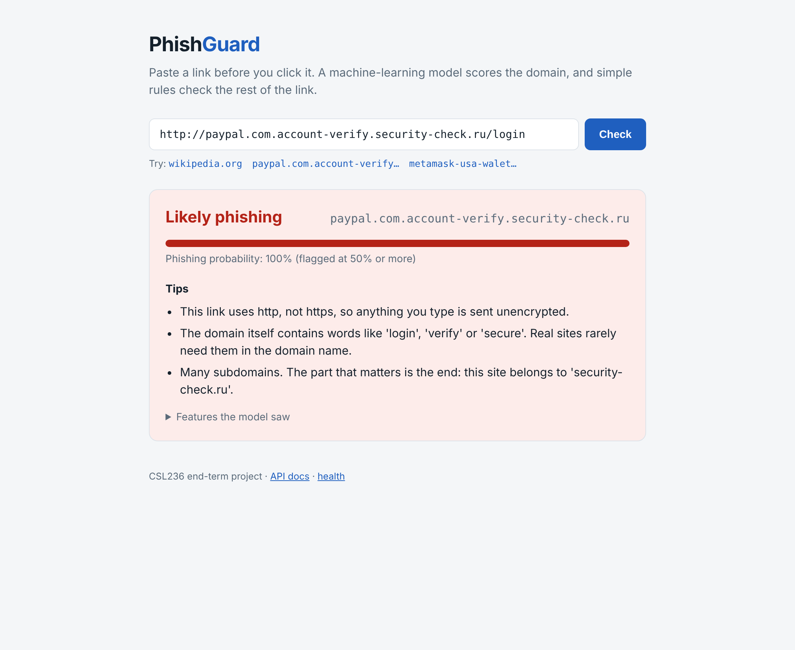
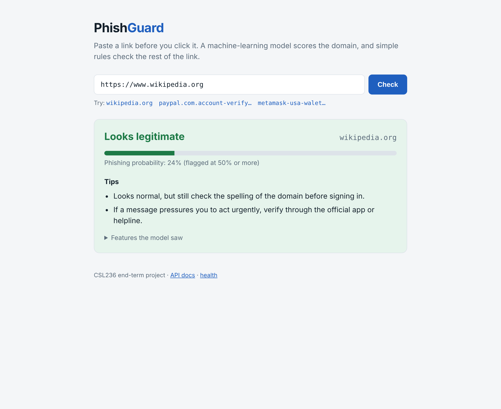
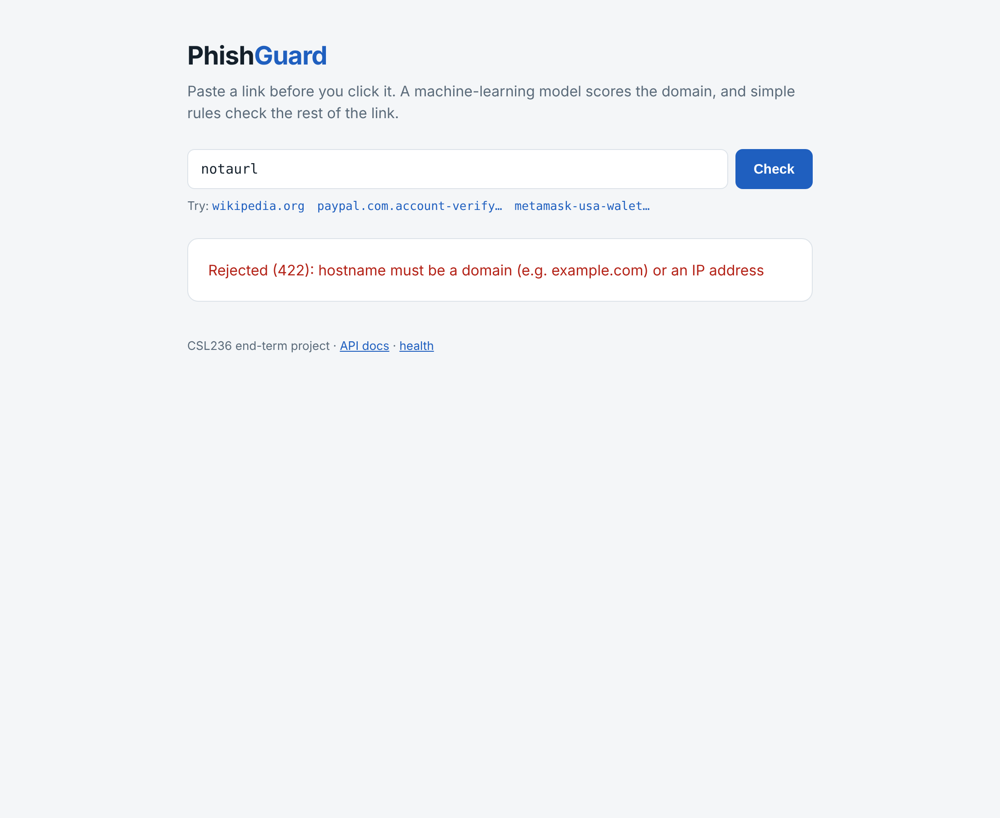
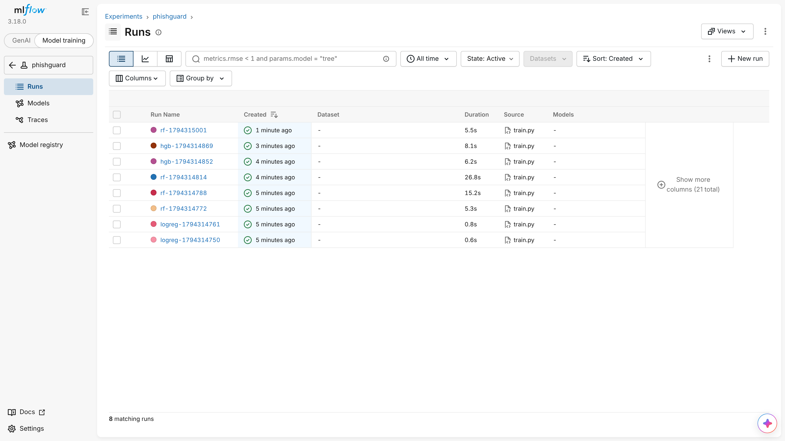

# PhishGuard: AI phishing-domain detector

CSL236 Introduction to AI and Machine Learning, end-term project (B.Tech CSE, Sem 5, The NorthCap University).

PhishGuard tells you whether a link is likely to be phishing **before** you click it. A gradient-boosting
model scores the link's hostname from 16 engineered features, and rule-based tips explain what looks risky
in the rest of the link. It ships as a production-style ML system: MLflow-tracked experiments, a validated
FastAPI service, pytest suite, Docker image, GitHub Actions CI and a live deployment.

**Live URL:** `<add after deploying>` · **API docs:** `<live URL>/docs`

---

## 1. Problem statement

Phishing links imitate real brands (`paypal.com.account-verify.security-check.ru`) or hide on free hosting
(`metamask-usa-walet.godaddysites.com`). Blocklists only know links that were already reported. PhishGuard
is a binary classifier that predicts `is_phishing` (1 = phishing, 0 = legitimate) for an unseen link from
the structure of its domain name alone.

## 2. Dataset

**PhiUSIIL Phishing URL dataset**: 235,795 URLs (134,850 legitimate, 100,945 phishing), mostly collected in 2023.

> Prasad, A. & Chandra, S. (2024). *PhiUSIIL Phishing URL (Website)*. UCI Machine Learning Repository, id 967.
> https://doi.org/10.1016/j.cose.2023.103545 · License: CC BY 4.0

The raw CSV is 54 MB (above the 50 MB limit), so it is **not committed**. `data/download_data.py` downloads
it, keeps only the `URL` and `label` columns, and flips the label (UCI uses 1 = legitimate) so that
`is_phishing = 1` means phishing. `train.py` runs the download automatically if the file is missing.

### EDA highlights (why the model only sees the hostname)

| Pattern in the raw URLs | Share that is phishing |
|---|---|
| URL has any path or query after the domain | **100%** |
| URL ends with `/` | **100%** |
| URL starts with `http://` | **100%** |
| URL starts with `https://www.` | 1.8% |

Legitimate rows are almost all bare `https://www.<domain>` homepages. A model trained on the full URL learns
"has a path = phishing" and would flag `https://github.com/anthropics`. So we **normalise every URL to its
hostname** (lower-cased, `www.` removed), **deduplicate by host** (235,795 URLs → 219,094 hosts, so the same
host can never be in both train and test) and **drop the 58 hosts labelled both ways**. Signals in the rest
of the URL (`@`, `http`, long links) are handled by rule-based tips instead.

## 3. Data contract

`POST /predict` takes these 16 features. Every constraint below is enforced by the Pydantic schema
`PhishFeatures` in `app.py` (strict types, no extra fields, NaN/Infinity rejected). Any violation returns
**HTTP 422**. `POST /predict-url` takes a raw URL, extracts the same features with `features.py`, and
validates them against the same contract.

| Feature | Type | Allowed range / values | Why it matters |
|---|---|---|---|
| `host_length` | int | 1 – 253 | Phishing hosts are longer, to imitate brands (`secure-paypal-login.com`). 253 is the DNS limit |
| `num_subdomains` | int | 0 – 125 | `paypal.com.evil.ru` stacks labels to put a brand in front of the real domain |
| `num_hyphens` | int | 0 – 252, ≤ host_length | Hyphenated look-alikes (`pay-pal-secure`) |
| `num_digits` | int | 0 – 253, ≤ host_length | Random ids and digit-for-letter swaps (`amaz0n`) |
| `digit_ratio` | float | 0.0 – 1.0, = num_digits / host_length (±0.01) | Same signal, independent of length |
| `is_ip` | int | {0, 1} | Real services don't send users to raw IP addresses |
| `host_entropy` | float | 0.0 – 6.0 | Randomness of characters. Machine-generated names score high |
| `suspicious_keyword_count` | int | 0 – 13 | Bait words in the domain (`login`, `verify`, `secure`, `bank`…) |
| `tld_length` | int | 0 – 63 (0 for IPs) | Unusual long TLDs (`.support`, `.monster`) |
| `has_punycode` | int | {0, 1} | `xn--` = internationalised name, used in homograph attacks (Cyrillic `а` in `аpple.com`) |
| `longest_label_length` | int | 1 – 253, ≤ host_length | One very long label hides a brand inside junk |
| `is_free_hosting` | int | {0, 1} | Free site builders (firebaseapp, weebly, godaddysites…) cost attackers nothing |
| `is_risky_tld` | int | {0, 1} | Cheap TLDs heavily abused for phishing (`.xyz`, `.top`, `.icu`…) |
| `vowel_ratio` | float | 0.0 – 1.0 | Random strings have unusually few vowels |
| `max_consonant_run` | int | 0 – 253, ≤ longest_label_length | `xkqzvbt`-style generated names |
| `digit_letter_switches` | int | 0 – 252 | `caseid1008934` style ids flip between letters and digits |
| **`is_phishing`** (target) | binary | {0, 1} | Label: 1 = phishing, 0 = legitimate |

Extra cross-field rule: if `is_ip = 1`, then `tld_length = 0` and `num_subdomains = 0`.

## 4. Experiments (MLflow, SQLite backend)

All runs: 219,036 unique hosts, stratified 80/20 split (`seed=42`), `class_weight="balanced"`, test-set metrics.
The positive class is phishing.

| Run | Algorithm | Hyperparameters | Accuracy | Precision | Recall | F1 | ROC-AUC |
|---|---|---|---|---|---|---|---|
| 1 | Logistic Regression (+ StandardScaler) | C=1.0 | 0.841 | 0.879 | 0.680 | 0.767 | 0.845 |
| 2 | Logistic Regression (+ StandardScaler) | C=0.1 | 0.842 | 0.881 | 0.680 | 0.768 | 0.846 |
| 3 | Random Forest | n_estimators=100, max_depth=6 | 0.841 | 0.882 | 0.677 | 0.766 | 0.850 |
| 4 | Random Forest | n_estimators=200, max_depth=12 | 0.853 | 0.904 | 0.690 | 0.782 | 0.863 |
| 5 | Random Forest | n_estimators=300, max_depth=20, min_samples_leaf=2 | 0.852 | 0.896 | 0.697 | 0.784 | 0.866 |
| 6 | HistGradientBoosting | learning_rate=0.1, max_iter=300 | 0.852 | 0.891 | 0.700 | 0.784 | 0.867 |
| **7** | **HistGradientBoosting** | **learning_rate=0.05, max_iter=600** | **0.852** | **0.892** | **0.700** | **0.784** | **0.867** |

Feature-engineering experiment: adding `is_risky_tld`, `vowel_ratio`, `max_consonant_run` and
`digit_letter_switches` raised gradient-boosting F1 from 0.743 to 0.784 and ROC-AUC from 0.846 to 0.867.

Reproduce:
```bash
python train.py --model logreg --C 1.0
python train.py --model logreg --C 0.1
python train.py --n_estimators 100 --max_depth 6
python train.py --n_estimators 200 --max_depth 12
python train.py --n_estimators 300 --max_depth 20 --min_samples_leaf 2
python train.py --model hgb --learning_rate 0.1 --max_iter 300
python train.py --model hgb --learning_rate 0.05 --max_iter 600
mlflow ui --backend-store-uri sqlite:///mlflow.db
```
`train.py` only overwrites `model/model.joblib` when a run beats the saved model's F1 (`model/model_meta.json`),
so the committed model is always the best run. `--force_save` overrides this (used by CI).

### Model choice

**HistGradientBoosting (learning_rate=0.05, max_iter=600)** is the deployed model:
- It has the best F1 (0.784) and ROC-AUC (0.867). Logistic Regression trails by ~0.02 AUC because the
  feature/label relationship isn't linear (e.g. risk rises sharply only past a certain host length).
- It ties the deepest Random Forest but trains about 3× faster (7 s vs 23 s) and the file is small (0.7 MB),
  which matters for a lean container and fast CI.
- F1 rather than accuracy is the selection metric because the classes are imbalanced (57/43) and both
  missed phishing (recall) and false alarms (precision) matter.

## 5. API

| Route | Method | Purpose |
|---|---|---|
| `/` | GET | Web UI: paste a link and get a verdict, probability and 2–3 tips |
| `/health` | GET | Liveness and the loaded model's algorithm and F1 |
| `/predict` | POST | The 16 contract features → verdict + phishing probability |
| `/predict-url` | POST | `{"url": "..."}` → host, features, verdict, probability, tips |
| `/docs` | GET | Swagger UI (auto-generated) |

The model is loaded **once at startup** (`MODEL = joblib.load(...)` at module level in `app.py`), never per request.
Every prediction is appended to `logs/predictions.jsonl` (timestamp, endpoint, hostname, features, probability,
verdict). Only the hostname is logged, never the full URL, because paths and queries can contain tokens.
A sample log is committed.

## 6. Setup and run

**Local**
```bash
python3 -m venv venv && source venv/bin/activate      # Windows: venv\Scripts\activate
pip install -r requirements.txt
python train.py --n_estimators 100 --max_depth 6       # downloads data on first run
uvicorn app:app --reload --port 8000                   # http://localhost:8000
pytest -v --tb=short
```

**Docker**
```bash
docker build -t phishguard .
docker run -d -p 8000:8000 --restart unless-stopped phishguard
docker image ls phishguard          # image size: 413 MB (measured in CI)
```
The image uses `python:3.11-slim` and installs only `requirements-serve.txt` (no MLflow, pandas or pytest).
It runs as a non-root user and has a `HEALTHCHECK` on `/health`.

**Drift check (bonus)**
```bash
python drift_check.py     # compares logged inputs' means with training mean/std
```

## 7. Tests

`tests/test_app.py` has 21 test cases:
- health check
- UI loads
- **domain logic:** a phishy host (`secure-login-verify-account8842.firebaseapp.com`) must score higher than `google.com`
- adding a URL path must not change the score (guards against the dataset shortcut)
- **boundary/contract 422s:** out-of-range values, wrong types (`"12"`, `12.5`, `true`), missing and unknown fields, **NaN**, inconsistent features, bad URLs
- `/predict-url` returns 2–3 tips and writes a privacy-safe log line

## 8. CI/CD

`.github/workflows/ci.yml` runs on every push and pull request to `main`:
1. **train-and-test:** install `requirements.txt`, download a 40k stratified sample, train a baseline RF, run pytest.
2. **docker-build:** build the image, start it, poll `/health`, print the image size.
3. **deploy (bonus CD):** if the repo secret `RENDER_DEPLOY_HOOK` is set, trigger a Render redeploy after the build passes.

## 9. Deployment (Render, free tier)

1. Push the repo to GitHub.
2. Render → **New → Web Service** → connect the repo → Runtime **Docker** → instance **Free**.
3. Render sets `PORT` automatically and the Dockerfile listens on it. Set the health check path to `/health`.
4. Render restarts crashed containers automatically (restart policy). Copy the public URL into this README.
5. Optional CD: Settings → Deploy Hook → copy the URL → GitHub repo → Settings → Secrets → `RENDER_DEPLOY_HOOK`.

## 10. Screenshots

| | |
|---|---|
| UI, phishing verdict |  |
| UI, legitimate verdict |  |
| UI, invalid input → 422 |  |
| MLflow runs |  |
| `/docs` | *add after deploying* |
| `pytest -v` | *add* |
| Green CI check | *add* |

## 11. Limitations and next steps

- **Hostname only.** Phishing hosted on a compromised legitimate domain (`realbusiness.com/wp-admin/paypal/`) is invisible to the model. Next: add page-content features (forms, external links) with an HTML crawler.
- **Legitimate data is homepages of registered domains**, so legitimate login subdomains look unusual. `login.microsoftonline.com` is a known false positive. Next: add legitimate subdomain URLs (e.g. from Common Crawl) and an allowlist of top domains.
- **Recall is 0.70.** Many phishing domains look ordinary (`meta-doublecrypto.com`). Lowering the threshold trades false alarms for recall. Next: tune the threshold on a validation set and add character n-gram or WHOIS domain-age features.
- **Dataset age (2023).** Attack patterns move. Next: evaluate on a 2026 dataset (e.g. Mendeley "Phishing URL dataset", 2026) and retrain when `drift_check.py` flags several features.
- `num_subdomains` is naive for multi-part suffixes (`bbc.co.uk` counts 1). Next: use the Public Suffix List.

## 12. Team

| Name | Roll no. | Contribution |
|---|---|---|
| Shivansh Saroha | 24CSU192 | `<fill in>` |
